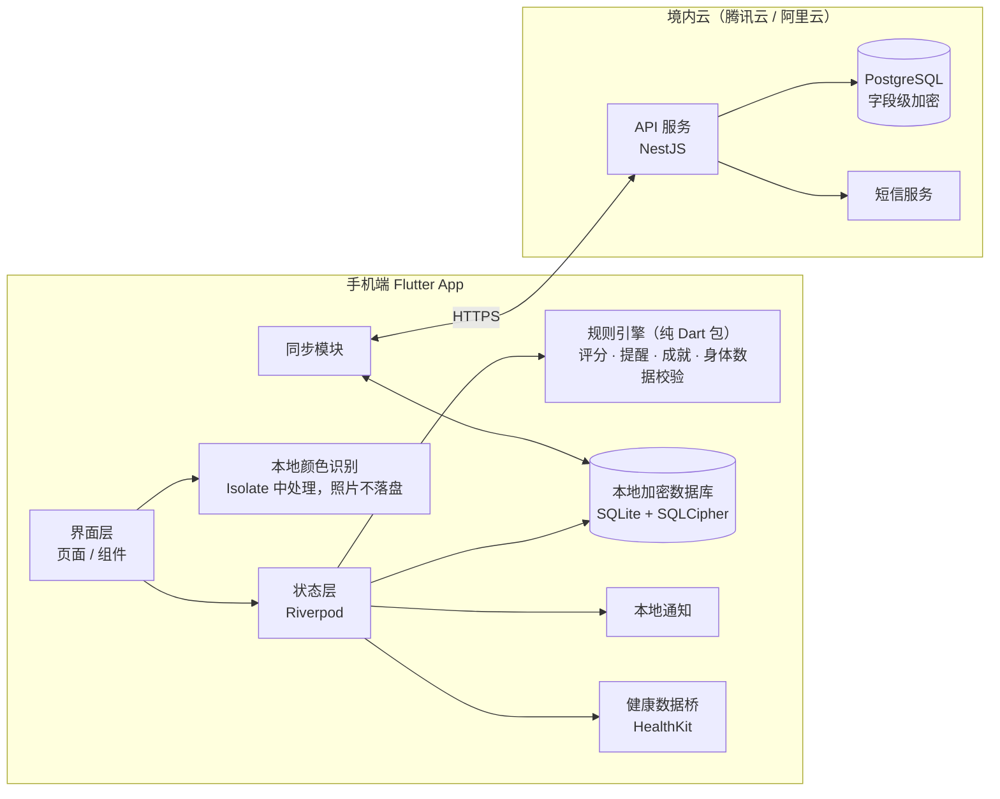

# 顺畅 App 技术方案（v1）

> 本文档面向开发团队，基于 `stool-score-app/index.html` 交互原型整理。
> 已确定的方向：**跨平台 App（Flutter）**、**照片只在手机本地识别**、**数据本地为主、登录后可云同步**、**团队开发，方案与核心模块由本文档定义**。

---

## 1. v1 范围

| 模块 | v1 包含 | v1 不包含 |
|---|---|---|
| 记录 | 拍照（本地识别颜色）、颜色/形状/顺畅度/饮水、症状/饮食/用药、补记（7 天内）、编辑删除、一天多次 | 云端 AI 识别形状 |
| 评分与提醒 | 评分算法、次数封顶、就医提醒、多日未排便提醒 | 按年龄分组的专属标准 |
| 查看 | 首页、日历（迷你评分圆环）、周/月趋势、周报月报、成就 | — |
| 账号 | 手机号 + 短信验证码、微信登录、Sign in with Apple；不登录也可完整使用 | — |
| 同步 | 登录后加密同步到境内服务器，换机恢复 | 多设备实时协同 |
| 提醒 | 本地定时通知（每日记录、喝水、多日未排便、每周报告） | 服务器推送 |
| 健康数据 | iOS「健康」读取饮水量、写入记录 | 安卓健康平台（v2，见 §9） |
| 导出 | 手机端生成 PDF / 文本报告，系统分享 | — |
| 合规 | 年龄 ≥14（14–17 需监护人同意）、健康信息单独同意、注销账号 | 14 岁以下 / 家庭成员模式 |

---

## 2. 总体架构

关键原则：

1. **评分和提醒完全在手机端计算**。服务器只存数据，不参与判断。没网也能用，规则改动也不会因为服务器不同步而出现两套结果。
2. **照片不出手机，也不写入存储**。识别完立即丢弃，记录里只保存颜色等结构化结果。
3. **未登录时不产生任何网络请求**（第三方 SDK 也要遵守，见 §8）。

---

## 3. 技术选型

| 领域 | 选择 | 说明 |
|---|---|---|
| 跨平台框架 | Flutter（Dart） | 一套代码出 iOS 和安卓；相机、通知、健康数据都有成熟插件 |
| 状态管理 | Riverpod | 好测试，便于把规则引擎做成纯函数注入 |
| 本地数据库 | drift（SQLite）+ SQLCipher | 结构化查询（日历、报告需要按日聚合）；整库加密，密钥存系统钥匙串（iOS Keychain / Android Keystore） |
| 相机 | camera 插件 | 用图像流（image stream）在内存中取帧，**不用拍照写文件的接口** |
| 本地识别 | Dart Isolate + image 包 | 后台线程计算颜色，界面不卡 |
| 本地通知 | flutter_local_notifications | 所有提醒都在手机本地排程，不需要推送服务器 |
| 健康数据 | health 插件 | iOS HealthKit；安卓 v2 再接 |
| PDF 导出 | pdf + printing 插件 | 手机端生成，调用系统分享 |
| 登录 | 短信（腾讯云/阿里云短信）、微信开放平台 SDK、Sign in with Apple | **iOS 上提供微信登录，就必须同时提供 Apple 登录**（App Store 审核指南 4.8） |
| 后端 | Node.js + NestJS + PostgreSQL | 团队易招人；也可换 Go，接口设计不变 |
| 部署 | 境内云服务器或容器服务 | 数据境内存储；需要 ICP 备案（见 §8） |

---

## 4. 数据模型（手机端，云端同结构）

所有表都有 `id`（UUID，手机端生成）、`updated_at`、`deleted`（软删除，同步用）。

**records 排便记录**

| 字段 | 类型 | 说明 |
|---|---|---|
| ts | datetime | 排便时间（可补记，最早 7 天前） |
| type | int 1–7 | 布里斯托分型 |
| color | enum | brown / yellow / green / black / red / pale |
| color_source | enum | auto（识别）/ manual |
| effort | enum | easy / normal / hard / vhard |
| water_cups | int | 当天喝水杯数（每杯 250 ml） |
| symptoms | string[] | 腹痛、腹胀、发热、恶心呕吐、便血、黏液、排不尽感 |
| diet | string[] | 辛辣、油腻、乳制品、酒精、咖啡浓茶、红心火龙果/甜菜、高纤维 |
| meds | string[] | 铁剂、铋剂、益生菌、泻药、抗生素、止泻药 |
| rule_version | string | 计算评分时的规则版本，例如 `2026.11-1` |
| score_cached | int | 当时计算出的分数，仅用于列表展示；以重新计算为准 |

**profile 个人信息**：昵称、性别、年龄、身高（cm）、体重（kg）、监护人同意（bool + 时间）、喝水目标（杯）、是否自动推荐。

**settings 设置**：提醒开关和时间、拍照预览模糊、健康数据授权状态、新手引导完成时间。

**badges 成就**：`badge_id`、`earned_at`。示例数据不参与成就计算。

**consents 同意记录**：隐私政策版本、健康信息单独同意、监护人同意、健康数据授权，每条都记录时间和版本号，用于合规举证。

---

## 5. 规则引擎（核心模块）

做成独立的纯 Dart 包 `packages/rules`，不依赖 Flutter，便于单元测试和医生、法务审核。原型里的同名函数就是参考实现，可以逐个对照移植。

### 5.1 单次评分（满分 100，权重不对用户展示）

| 项目 | 满分 | 规则 |
|---|---|---|
| 形状 | 40 | 1 型 10，2 型 24，3 型 37，4 型 40，5 型 30，6 型 16，7 型 6 |
| 颜色 | 25 | 棕 25，黄 18，绿 16，黑 4，灰白 4，红 0 |
| 顺畅度 | 20 | 很轻松 20，还行 16，有点费劲 8，非常费劲 3 |
| 饮水 | 15 | ≥目标 15；≥75% 12；≥50% 8；其余 3 |
| 症状扣分 | — | 每个症状 −4，最多 −12 |

原型函数：`rawScore`、`waterPts`。

### 5.2 一天多次的封顶

- 单次上限按「当天第几次」：1–3 次不限；第 4 次 79；第 5 次 69；第 6–7 次 59；第 8 次及以上 45。
- 当天此前已有 ≥2 次稀便（6、7 型），这一次最高 79。
- 当天总分 = 各次封顶后的平均分 − 超过 2 次的稀便每次 6 分，再受当天总次数的上限约束。

原型函数：`freqCap`、`capOf`、`scoreOf`、`dayScore`。

### 5.3 等级与配色

完美 ≥95，优秀 80–94，良好 60–79，一般 40–59，需关注 <40。各项指标按自身得分率用同一套等级。原型函数：`band`。

### 5.4 提醒规则

原型函数 `evaluateAlerts` 是完整清单，主要包括：

- 黑色或红色：如果记录了铁剂、铋剂（黑）或红色食物（红），只做说明；否则建议尽快就医。
- 近 3 天灰白色；记录便血；稀便同时发热：建议就医。
- 当天稀便 ≥3 次提示留意；≥6 次，或当天总次数 ≥8，建议就医；连续 3 天稀便建议就医。
- 7 天内 ≥3 天偏硬；连续 3 天评分 <40；3 天以上没有记录（7 天以上建议就医）。

**用语规范（必须遵守）**：只描述用户记录的情况；不出现疾病名称和病因推断；不推荐具体科室和药物用法；统一使用「建议就医 / 咨询医生」。所有提醒文案集中放在一个文案文件里，方便法务逐条审核。

### 5.5 身体数据校验

- 年龄 14–100（滚轮从 14 开始）；14–17 岁必须勾选监护人同意。原型函数：`gateOk`。
- 按年龄对照身高、体重的大致范围；成人另查 BMI 15–40。超出范围时提示可能填错，不推荐喝水量，需要二次确认。原型函数：`refFor`、`oddity`。
- 推荐喝水量：体重 × 30 ml（65 岁以上 × 0.9），5–12 杯；未成年不推荐。原型函数：`suggestedCups`、`goalEval`。

### 5.6 版本管理

- 每次修改规则，`rule_version` 加一，并在 `CHANGELOG` 里写明改动和审核人（医生、法务）。
- 历史记录展示时用当前规则重新计算；报告注明使用的规则版本。
- 单元测试覆盖原型里验证过的用例，例如「一天 6 次：55、65、79、79、69、59，当天总分 59」。

---

## 6. 拍照与本地识别

1. 相机打开后，从图像流取一帧放在内存里，**不调用会写文件的拍照接口**；从相册选择的图片，读取后立即释放。
2. 在 Isolate 中把图片缩到 120 px 宽，取中间 60% 区域，排除接近白色（马桶）和偏蓝（水）的像素，计算平均颜色，再按色相、亮度、饱和度映射到 6 种颜色。参考原型 `analyzeImage`。
3. 预览默认模糊（可在设置中关闭），识别完成后清空图片数据，记录里只保存 `color` 和 `color_source`。
4. 形状由用户手动选择。将来如果要做 AI 识别形状，见 §9。

---

## 7. 同步与后端

- **接口**（全部 HTTPS，JWT 鉴权）：
  - `POST /auth/sms/send`
  - `POST /auth/sms/verify`
  - `POST /auth/wechat`
  - `POST /auth/apple`
  - `GET /sync?since=<cursor>`：拉取对方的变更
  - `POST /sync`：批量提交本地变更
  - `DELETE /account`：注销，删除全部数据
- **同步策略**：每条记录按 `updated_at` 以后写入的为准（last-write-wins）；删除用软删除标记，30 天后物理清除；首次登录时把本地数据整体上传合并。
- **服务器存储**：症状、饮食、用药等健康字段做字段级加密（密钥放云厂商的密钥管理服务 KMS）；数据库开启静态加密；访问日志不记录健康字段内容。
- **注销账号**：服务端立即停用账号，15 个工作日内删除数据（以法务确认的期限为准），手机端同时清空本地库。

---

## 8. 合规与上架清单

> 以下需要法务确认，这里只列技术上要配合的点。

- [ ] **健康信息单独同意**：首次记录前弹出，内容包括收集项、用途、存储位置；记录到 `consents` 表。
- [ ] 隐私政策、个人信息收集清单、**第三方 SDK 共享清单**（微信、短信、崩溃统计等）；未同意隐私政策前，不初始化任何第三方 SDK。
- [ ] 年龄门槛与监护人同意（已在原型实现）；隐私政策写明发现儿童使用时删除数据的流程。
- [ ] **ICP 备案、App 备案**（境内上架必需）；数据存储在境内。
- [ ] 个人信息保护影响评估（处理敏感个人信息前完成）。
- [ ] 服务器按等级保护要求做安全加固（具体级别由法务和安全评估确定）。
- [ ] App Store：Sign in with Apple；HealthKit 数据不得用于广告；隐私标签如实填写；医疗类 App 的描述避免出现诊断用语。
- [ ] 商店描述、截图、推送文案同样遵守 §5.4 的用语规范。

---

## 9. 以后的版本（v2 以后）

- **安卓健康数据**：国内主流是华为运动健康、小米健康等，需要分别接入各自的 SDK；Health Connect 在国内覆盖有限。
- **AI 识别形状**：
  - 首选手机本地模型（TFLite / Core ML），照片仍然不出手机。
  - 训练数据需要用户另行授权捐赠，并有专人标注；也可以与医院合作获取数据。
  - 上线前评估是否会被认定为医疗器械软件。
- **家庭成员模式**（14 岁以下）：见产品讨论记录中的第二版方案，需要儿童个人信息保护规则和儿科医生审核。

---

## 10. 里程碑（参考，按 2–3 人团队估算）

| 阶段 | 内容 | 预计 |
|---|---|---|
| M0 | 工程搭建、CI、设计稿对齐、规则引擎包和单元测试 | 1–2 周 |
| M1 | 本地记录全流程：拍照识别、评分、首页、日历、结果页、本地加密库 | 3–4 周 |
| M2 | 提醒通知、周报月报和 PDF、成就、新手引导和年龄门槛、HealthKit | 2–3 周 |
| M3 | 账号体系、后端、同步、注销 | 3 周 |
| M4 | 合规材料、安全加固、测试、备案、上架审核 | 2–4 周（备案周期不可控） |

---

## 11. 待确认的问题

1. 规则的医学审核：找哪位医生（科室）审核评分权重、阈值和提醒文案？
2. 微信登录需要以**企业主体**注册微信开放平台，你们有主体了吗？
3. 是否需要后台运营数据（例如日活、留存）？如果需要，统计只能用匿名数据，且必须写进隐私政策。
4. 品牌名「顺畅」是否已做商标检索？
