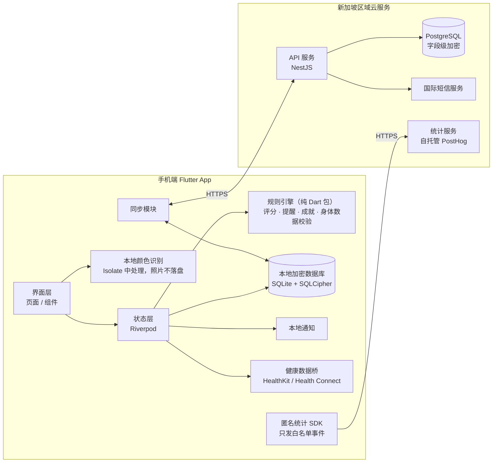

# 拉了么 App 技术方案（v1）

> 本文档面向开发团队，基于 `stool-score-app/index.html` 交互原型整理。
>
> 已确定的方向：
> - **运营主体**：Neighbor（新加坡公司）
> - **市场**：首批上线**美国、加拿大、新加坡**（App Store、Google Play），首批用户以美国和新加坡为主；以后再进入中国大陆
> - **语言**：第一版做**简体中文、繁体中文、英文、法文、马来文**五个版本，用户在「我的 → 语言」里切换，首次打开按手机系统语言自动选择
> - **服务器**：**新加坡**
> - **App 名称**：暂定「拉了么」，可能更改。名字只在一个配置文件里定义，改名不用动代码
> - **数据保护负责人**：由 Neighbor 公司负责，对外公开统一的隐私联系邮箱
> - **技术路线**：跨平台 App（Flutter）；照片只在手机本地识别；数据本地为主，登录后可云同步
> - **分工**：团队开发，方案与核心模块由本文档定义
> - **需要运营数据**：日活、留存等，采用匿名统计（见 §8）

---

## 1. v1 范围

| 模块 | v1 包含 | v1 不包含 |
|---|---|---|
| 记录 | 拍照（本地识别颜色）、颜色/形状/顺畅度/饮水、症状/饮食/用药、补记（7 天内）、编辑删除、一天多次 | 云端 AI 识别形状 |
| 评分与提醒 | 评分算法、次数封顶、就医提醒、多日未排便提醒 | 按年龄分组的专属标准 |
| 查看 | 首页、日历（迷你评分圆环）、周/月趋势、周报月报、成就 | — |
| 账号 | **进入 App 时就展示登录页**（新手引导第 2 步）：Apple 登录、Google 登录、手机号登录/注册（默认 +1，可选 +65 等）。页面右上角保留「先不登录」，见下方说明。「我的」页只显示账号状态和「登录」按钮 | 微信登录 |
| 语言 | 简体中文、繁体中文（台湾用语习惯）、英文、法文（加拿大法语）、马来文；「我的」页和欢迎页都能切换 | — |
| 身体数据输入 | 新手引导用上下滚轮；「我的」页显示固定数值，点开后用**刻度盘**左右拖动精确调整（见 §6.1） | — |

> **为什么登录页要保留「先不登录」**：App Store 审核指南 5.1.1 规定，如果 App 的核心功能不依赖账号，就不能强制用户注册登录，否则可能被拒。「拉了么」的记录、评分、提醒都能离线使用，所以登录页放在最前面引导登录，但保留一个不显眼的跳过入口。
| 同步 | 登录后加密同步到新加坡区域的服务器，换机恢复 | 多设备实时协同 |
| 提醒 | 本地定时通知（每日记录、喝水、多日未排便、每周报告） | 服务器推送 |
| 健康数据 | iOS「健康」读取饮水量、写入记录；安卓 Health Connect | — |
| 导出 | 手机端生成 PDF / 文本报告，系统分享 | — |
| 统计 | 匿名使用统计（日活、留存、功能使用），可关闭 | 任何健康数据进入统计 |
| 合规 | 年龄 ≥14（14–17 需监护人同意）、健康信息单独同意、注销账号 | 14 岁以下 / 家庭成员模式 |

---

## 2. 总体架构

关键原则：

1. **评分和提醒完全在手机端计算**。服务器只存数据，不参与判断。
2. **照片不出手机，也不写入存储**。识别完立即丢弃，记录里只保存颜色等结构化结果。
3. **健康数据和统计数据分开**。统计只接收白名单里的事件，不含任何记录内容。
4. **按地区部署**：每个用户带一个 `region` 标记，服务端按地区路由。现在只有新加坡一个地区，以后进入大陆时，新增一套部署在大陆的服务和数据库，代码不用重写（见 §10）。

---

## 3. 技术选型

| 领域 | 选择 | 说明 |
|---|---|---|
| 跨平台框架 | Flutter（Dart） | 一套代码出 iOS 和安卓 |
| 状态管理 | Riverpod | 好测试，便于把规则引擎做成纯函数注入 |
| 本地数据库 | drift（SQLite）+ SQLCipher | 日历、报告需要按日聚合查询；整库加密，密钥存系统钥匙串（iOS Keychain / Android Keystore） |
| 相机 | camera 插件 | 用图像流在内存中取帧，**不用写文件的拍照接口** |
| 本地识别 | Dart Isolate + image 包 | 后台线程计算颜色 |
| 本地通知 | flutter_local_notifications | 所有提醒都在手机本地排程 |
| 健康数据 | health 插件 | iOS HealthKit、安卓 Health Connect |
| PDF 导出 | pdf + printing 插件 | 手机端生成，调用系统分享 |
| 登录 | 国际短信（Twilio 等）、Sign in with Apple、Google 登录 | iOS 上只要提供了第三方登录，就必须同时提供 Apple 登录（App Store 审核指南 4.8）。美国短信需要先完成运营商注册（10DLC 或免费号码验证），提前 2–4 周办理 |
| 多语言 | Flutter 官方国际化（intl / ARB 文件） | 所有文字放进语言文件。原型的翻译表在 `stool-score-app/i18n/`（zh-Hant / en / fr / ms，以简体中文原文为键，共 573 条），可以直接转成 ARB。日期、星期、月份用系统的本地化格式。翻译上线前需要请母语人士校对，尤其是法文和马来文的医疗相关提醒 |
| 后端 | Node.js + NestJS + PostgreSQL | 也可换 Go，接口设计不变 |
| 部署 | **新加坡区域**（已确定） | 不管选哪里，都要在隐私政策里说明数据存储地和跨境传输。以后进入大陆时，用阿里云或腾讯云部署同一套服务会更顺 |
| 统计 | PostHog 自托管（新加坡区域） | 数据在自己服务器上，方便满足隐私要求；也可换 Amplitude、Firebase Analytics，但要在隐私政策中写明第三方 |

---

## 4. 数据模型（手机端，云端同结构）

所有表都有 `id`（UUID，手机端生成）、`updated_at`、`deleted`（软删除，同步用）。

**records 排便记录**

| 字段 | 类型 | 说明 |
|---|---|---|
| ts | datetime | 排便时间（可补记，最早 7 天前），存 UTC，展示用设备时区 |
| type | int 1–7 | 布里斯托分型 |
| color | enum | brown / yellow / green / black / red / pale |
| color_source | enum | auto（识别）/ manual |
| effort | enum | easy / normal / hard / vhard |
| water_cups | int | 当天喝水杯数（每杯 250 ml） |
| symptoms | string[] | 腹痛、腹胀、发热、恶心呕吐、便血、黏液、排不尽感 |
| diet | string[] | 可选，记录页默认折叠：辛辣油腻、乳制品、酒精、咖啡浓茶、深色或红色食物 |
| meds | string[] | 创建记录时从 profile 里**未到期**的用药复制（快照）；记录页可对单次点「这次没吃」或「已经停药」。选项：铁剂、铋剂（部分胃药）、泻药/软便剂、止泻药、抗生素、益生菌。不提供自由填写 |
| med_asked | bool | 结果页当场问过用药后置为 true，同一条记录不再重复问 |
| rule_version | string | 计算评分时的规则版本，例如 `2026.11-1` |
| score_cached | int | 当时算出的分数，仅用于列表展示；以重新计算为准 |

**profile 个人信息**：昵称、性别、年龄、身高（cm）、体重（kg）、监护人同意（bool + 时间）、喝水目标（杯）、是否自动推荐、正在服用的药物（meds：`[{ id, until }]`，在「我的」页添加时选择服用 3 / 7 / 14 / 30 天或长期；`until` 为到期日，长期为 null；到期后自动不再带入新记录）、`region`。

**settings 设置**：提醒开关和时间、拍照预览模糊、匿名统计开关、健康数据授权状态、新手引导完成时间。

**badges 成就**：`badge_id`、`earned_at`。示例数据不参与成就计算。

**consents 同意记录**：隐私政策版本、健康信息单独同意、监护人同意、健康数据授权、统计同意。每条记录时间和版本号，用于合规举证。

---

## 5. 规则引擎（核心模块）

做成独立的纯 Dart 包 `packages/rules`，不依赖 Flutter，便于单元测试和审核。原型里的同名函数就是参考实现，可以逐个对照移植。

### 5.1 单次评分（满分 100，权重不对用户展示）

| 项目 | 满分 | 规则 |
|---|---|---|
| 形状 | 40 | 1 型 10，2 型 24，3 型 37，4 型 40，5 型 30，6 型 16，7 型 6 |
| 颜色 | 25 | 棕 25，黄 18，绿 16，黑 4，灰白 4，红 0 |
| 顺畅度 | 20 | 很轻松 20，还行 16，有点费劲 8，非常费劲 3 |
| 饮水 | 15 | ≥目标 15；≥75% 12；≥50% 8；其余 3 |
| 症状扣分 | — | 每个症状 −4，最多 −12 |

原型函数：`rawScore`、`waterPts`。

### 5.2 一天多次的封顶

- 单次上限按「当天第几次」：1–3 次不限；第 4 次 79；第 5 次 69；第 6–7 次 59；第 8 次及以上 45。
- 当天此前已有 ≥2 次稀便（6、7 型），这一次最高 79。
- 当天总分 = 各次封顶后的平均分 − 超过 2 次的稀便每次 6 分，再受当天总次数的上限约束。

原型函数：`freqCap`、`capOf`、`scoreOf`、`dayScore`。

### 5.3 等级与配色

完美 ≥95，优秀 80–94，良好 60–79，一般 40–59，需关注 <40。各项指标按自身得分率用同一套等级。原型函数：`band`。

### 5.4 提醒规则

原型函数 `evaluateAlerts` 是完整清单，主要包括：

- 黑色或红色：如果记录了铁剂、铋剂（黑），或深色或红色食物（黑、红），只做说明；否则建议尽快就医。
- **当场询问用药**：大便发黑但没有记录铁剂或铋剂时，就医提醒里直接问「最近在吃铁剂或铋剂吗？」；稀便但没有记录泻药时，在结果页问「最近在吃泻药或软便剂吗？」。用户回答后补进这条记录并重新判断，同一条记录只问一次。这样即使用户没在「我的」里设置用药，影响判断时也能问到。
- 近 3 天灰白色；记录便血；稀便同时发热：建议就医。
- 当天稀便 ≥3 次提示留意；≥6 次，或当天总次数 ≥8，建议就医；连续 3 天稀便建议就医。
- 7 天内 ≥3 天偏硬；连续 3 天评分 <40；3 天以上没有记录（7 天以上建议就医）。

**用语规范（必须遵守）**：只描述用户记录的情况；不出现疾病名称和病因推断；不推荐具体科室和药物用法；统一使用「建议就医 / 咨询医生」。急救电话按用户所在地区显示。所有提醒文案集中放在一个文案文件里，方便逐条审核。

### 5.5 身体数据校验

- 年龄 14–100（滚轮从 14 开始）；14–17 岁必须勾选监护人同意。原型函数：`gateOk`。
- 按年龄对照身高、体重的大致范围；成人另查 BMI 15–40。超出范围时提示可能填错，不推荐喝水量，需要二次确认。原型函数：`refFor`、`oddity`。
- 推荐喝水量：体重 × 30 ml（65 岁以上 × 0.9），5–12 杯；未成年不推荐。原型函数：`suggestedCups`、`goalEval`。

### 5.6 版本管理

- 每次修改规则，`rule_version` 加一，并在 `CHANGELOG` 里写明改动、依据（见 §9）和审核人。
- 历史记录展示时用当前规则重新计算；报告注明使用的规则版本。
- 单元测试覆盖原型里验证过的用例，例如「一天 6 次：55、65、79、79、69、59，当天总分 59」。

---

## 6. 拍照与本地识别

1. 相机打开后，从图像流取一帧放在内存里，**不调用会写文件的拍照接口**；从相册选择的图片，读取后立即释放。
2. 在 Isolate 中把图片缩到 120 px 宽，取中间 60% 区域，排除接近白色（马桶）和偏蓝（水）的像素，计算平均颜色，再按色相、亮度、饱和度映射到 6 种颜色。参考原型 `analyzeImage`。
3. 预览默认模糊（可在设置中关闭），识别完成后清空图片数据，记录里只保存 `color` 和 `color_source`。
4. 形状由用户手动选择。

---

### 6.1 刻度盘选择器（「我的」页的年龄、身高、体重）

交互参考 iPhone 相机的变焦刻度盘，配色使用 App 的橙黄主色：

- 底部弹出面板：顶部是「取消 / 项目名 / 完成」，中间是大号数值，下面是一段弧形刻度盘，正中有橙色指针。
- 左右拖动刻度盘调整数值；松手后有惯性滑动，最后吸附到最近的刻度。
- 每跨过一个刻度触发一次**轻触震动**。Flutter 用 `HapticFeedback.selectionClick()`；原型在浏览器里用 `navigator.vibrate`，iPhone 的浏览器不支持网页震动，正式 App 里没有这个限制。
- 刻度：年龄、身高每 1 一格，每 5 中刻度，每 10 长刻度并标数字；体重每 0.5 kg 一格，每 1 kg 中刻度，每 5 kg 长刻度。
- 年龄最小 14：到头后继续拖会回弹，并提示「本产品暂不支持 14 岁以下的用户」。
- 无障碍：刻度盘可以用键盘左右键调整，旁边还有 − / + 按钮，方便不擅长拖动的用户。
- Flutter 实现建议：`CustomPainter` 画刻度，`GestureDetector` 处理拖动，用 `FrictionSimulation` 做惯性。

## 7. 同步与后端

- **接口**（全部 HTTPS，JWT 鉴权）：
  - `POST /auth/sms/send`（带国家区号）
  - `POST /auth/sms/verify`
  - `POST /auth/apple`
  - `POST /auth/google`
  - `GET /sync?since=<cursor>`：拉取对方的变更
  - `POST /sync`：批量提交本地变更
  - `GET /account/export`：导出本人全部数据（满足数据访问请求）
  - `DELETE /account`：注销，删除全部数据
- **同步策略**：每条记录按 `updated_at` 以后写入的为准（last-write-wins）；删除用软删除标记，30 天后物理清除；首次登录时把本地数据整体上传合并。
- **服务器存储**：症状、饮食、用药等健康字段做字段级加密（密钥放云厂商的密钥管理服务 KMS）；数据库开启静态加密；访问日志不记录健康字段内容。
- **短信防刷**：同一号码 60 秒一次、每天上限；接入图形或行为验证码，防止被刷短信费。
- **注销账号**：服务端立即停用账号，在隐私政策承诺的期限内删除数据，手机端同时清空本地库。

### 7.1 服务器放美国还是新加坡

两个区域都能用。同步不是实时功能，跨太平洋 200 毫秒左右的延迟对用户几乎没有影响，所以主要看成本和合规。

| 对比项 | 美国区域 | 新加坡区域 |
|---|---|---|
| 服务器、数据库价格 | 通常最便宜 | 同一家云厂商一般贵 10%–20% |
| 出网流量费 | 较低 | 较高 |
| 短信费用 | 主要取决于用户的手机号所在地，与服务器区域无关。美国号码单条便宜，但要先做运营商注册；新加坡号码单条更贵 | 同左 |
| 合规 | 新加坡用户的数据存到美国，需要按 PDPA 的跨境传输要求，确保对方的保护水平相当（一般靠合同条款） | 美国、加拿大用户的数据存到新加坡，需要在隐私政策里说明；魁北克用户需要先做隐私影响评估 |

**已确定使用新加坡区域。** 美国和加拿大用户的数据会存到新加坡，隐私政策里要写明（原型的隐私政策已改为「数据存储在新加坡」），魁北克用户需要先做隐私影响评估。用户量不大时（1 万人以内），一台 2 核 4G 的服务器加一个小规格托管数据库就够用，每月大约几十到一百多美元。具体价格以云厂商官网报价为准，正式选型前请团队按实际配置算一遍。

**另外**：在 App 里允许用户「先不登录」，可以明显降低服务器和短信成本，因为不登录的用户完全不产生服务器费用。

---

## 8. 运营数据统计

**原则：统计数据里不能出现任何健康信息。**

- **身份**：只用随机生成的匿名 ID；登录后也不把手机号、昵称等发给统计服务。
- **事件白名单**（只允许这些事件和属性，代码里写死，新增要评审）：

| 事件 | 属性 | 用途 |
|---|---|---|
| `app_open` | 版本号、系统、语言、地区 | 日活、留存 |
| `onboarding_step` | 步骤编号、是否完成 | 引导转化 |
| `record_saved` | 是否拍照、是否补记、是否编辑、**是否填写了饮食**（只记有没有填，不记填了什么） | 核心功能使用；根据饮食的填写率决定以后要不要扩充选项 |
| `page_view` | 页面名（首页/日历/报告/成就/我的） | 功能热度 |
| `reminder_toggled` | 提醒类型、开或关 | 提醒使用 |
| `report_opened` | 周报或月报 | 报告使用 |
| `badge_earned` | 成就 ID | 激励效果 |
| `login` / `logout` | 登录方式 | 账号转化 |

- **禁止**出现在统计里的内容：评分、颜色、形状、症状、饮食、用药、身体数据、提醒内容、页面上的文字。
- **开关**：「我的 → 数据与隐私 → 匿名使用统计」，关闭后不再上报（原型已有这个开关）。用户同意隐私政策之前不初始化统计 SDK。
- **为什么必须自托管、不能接广告类 SDK**：在美国，「某人在用排便记录 App」本身就可能被当作健康信息。华盛顿州《我的健康我的数据法》（My Health My Data Act）要求收集这类数据前取得同意，分享给第三方还要另行同意，而且允许个人起诉。美国联邦贸易委员会（FTC）也处罚过多家把健康 App 数据发给广告和分析平台的公司。所以统计服务自己部署、数据不出公司，App 内不接入任何广告 SDK，并在首次使用时的同意页里单独列出统计选项。
- **指标**：日活和月活、次日/7 日/30 日留存、新手引导完成率、每周人均记录天数、提醒开启率。

---

## 9. 没有医生审核时怎么降低风险

目前没有医生参与。建议这样处理：

1. **定位只做「记录和提醒」**：所有文案遵守 §5.4 的用语规范，不做任何医学判断。
2. **阈值有公开出处**：每条规则在 `CHANGELOG` 里注明参考的公开资料，例如布里斯托分型、公共卫生机构的健康教育材料（新加坡 HealthHub、英国 NHS 等），不自己发明医学结论。
3. **宁可多提醒**：拿不准的情况一律引导「咨询医生」，不给「没事」的结论。
4. **邀请医生内测**：给相关行业的医生发邮件，请他们试用测试版并反馈。邀请邮件和反馈清单见 `docs/医生内测邀请.md`。
   - iOS 用 TestFlight 外部测试（最多 1 万人，首次需要苹果做测试版审核）；安卓用 Google Play 内部测试或封闭测试。
   - 每条反馈都存档，并注明对应改了哪条规则或文案，写进 `CHANGELOG`。
   - 内测反馈不等于正式的医学审核。对外宣传中不能写「医生认证」「经医生审核」，除非医生书面同意并且确实做过正式审核。
5. **保留免责声明**，但不要把它当成唯一保护。

---

## 10. 合规与上架清单

> 以下需要律师确认，这里只列技术上要配合的点。

### 10.1 首批上线：美国、加拿大、新加坡

**三地通用**

- [ ] **健康信息单独同意**：首次记录前弹出，内容包括收集项、用途、存储地；匿名统计作为单独选项。记录到 `consents` 表。
- [ ] 隐私政策写明：运营方 Neighbor（新加坡）、数据存储地、跨境传输、第三方服务清单（短信、统计、崩溃收集、Apple/Google 登录）、隐私联系邮箱。
- [ ] 不出售数据、不接广告 SDK、不把健康信息分享给广告商（原型隐私政策已写入）。
- [ ] 支持用户导出、更正、删除自己的数据（`/account/export`、编辑记录、`DELETE /account`）。
- [ ] 年龄门槛 14 岁、14–17 岁需监护人同意（已在原型实现）；发现儿童使用时删除数据的流程。
- [ ] 急救电话按地区显示：美国和加拿大 911、新加坡 995（原型已改）。

**美国**

- [ ] **FDA「一般健康」类产品边界**：只鼓励健康生活方式、不涉及诊断和治疗疾病的低风险软件，FDA 通常不按医疗器械监管。保持 §5.4 的用语规范，并请律师按 FDA 的 General Wellness 指南确认。
- [ ] **FTC 健康数据泄露通知规则**（Health Breach Notification Rule）：个人健康记录类 App 发生数据泄露或未经授权的分享，需要通知用户和 FTC。
- [ ] **州法**：华盛顿州《我的健康我的数据法》、内华达州类似法律、加州消费者隐私法（CCPA/CPRA，健康信息属于敏感信息）。需要单独的「消费者健康数据隐私政策」，收集和分享分别取得同意。
- [ ] HIPAA 一般不适用于直接面向消费者、不和医院保险合作的 App；以后如果和医疗机构合作，需要重新评估。
- [ ] 美国短信运营商注册（见 §3）。

**加拿大**

- [ ] 联邦《个人信息保护和电子文件法》（PIPEDA）：同意、用途说明、跨境传输的告知。
- [ ] **魁北克省 25 号法律**：必须有个人信息保护负责人（默认是公司最高负责人，可书面委托）；数据传到魁北克以外之前要做隐私影响评估；默认采用最高隐私设置。
- [ ] **魁北克法语要求**：在魁北克提供的软件，可能要求有法语版本。请律师确认，必要时 v1 就加法语。
- [ ] 加拿大卫生部对医疗器械软件的界定和美国类似，不做诊断通常不在范围内，同样请律师确认。

**新加坡**

- [ ] **PDPA**：收集前同意、说明用途；指定数据保护负责人并公开联系方式（由公司承担，但需要指定具体负责的人）；数据泄露按规定期限通知个人数据保护委员会和受影响用户。
- [ ] 卫生科学局（HSA）的医疗器械软件边界，同上。

**应用商店**

- [ ] App Store：Sign in with Apple；HealthKit 数据不得用于广告或出售；隐私标签如实填写；描述、截图不出现诊断用语；健康类 App 可能被要求提供数据来源说明。
- [ ] Google Play：填写健康类应用声明和数据安全表单；Health Connect 权限要说明用途；以公司身份注册开发者账号（个人账号有 12 人、14 天的封闭测试要求）。
- [ ] App 名称在各商店需唯一；如果已有同名 App，上架时可能要换名或加副标题。

### 10.2 以后进入中国大陆时

- 需要在大陆设立主体（例如外商独资企业），或与大陆公司合作运营。
- ICP 备案、App 备案；大陆用户数据存储在大陆境内（新增一套大陆部署，见 §2 第 4 条）。
- 按《个人信息保护法》处理敏感个人信息（单独同意、影响评估）；从境内向境外传输数据需要走数据出境的合规程序。
- 登录换成大陆短信服务（短信签名需要大陆主体），可加微信登录；安卓上架国内各大应用商店（通常要求软件著作权证书）。

---

## 11. 里程碑（参考，按 2–3 人团队估算）

| 阶段 | 内容 | 预计 |
|---|---|---|
| M0 | 工程搭建、CI、设计稿对齐、规则引擎包和单元测试 | 1–2 周 |
| M1 | 本地记录全流程：拍照识别、评分、首页、日历、结果页、本地加密库 | 3–4 周 |
| M2 | 提醒通知、周报月报和 PDF、成就、新手引导和年龄门槛、健康数据 | 2–3 周 |
| M3 | 账号体系、后端、同步、注销与数据导出、匿名统计 | 3 周 |
| M4 | 外部医生审核、法律文件、安全测试、商店审核 | 2–3 周 |

---

## 12. 待确认的问题

1. **App 名称**：暂定「拉了么」，可能更改。现在市场上已有同名、不同内容的 App，而且这个名字和「饿了么」接近。定名前建议做商标检索，并确认各商店能否使用。
2. **翻译校对**：英文、法文、马来文由谁校对？建议每种语言找一位母语人士，医疗相关提醒请内测医生一起看。
3. **繁体中文的用语**：目前按台湾习惯（例如「登入」「資料」「使用者條款」）。如果香港用户多，部分用语需要另做一版。
4. **数据保护负责人**：由公司承担，但新加坡和魁北克都要求指定具体负责的人，并公开联系方式（例如 `privacy@` 邮箱）。由谁担任？
5. **医生内测**：准备邀请哪些医生？测试版计划什么时候发出？见 `docs/医生内测邀请.md`。
